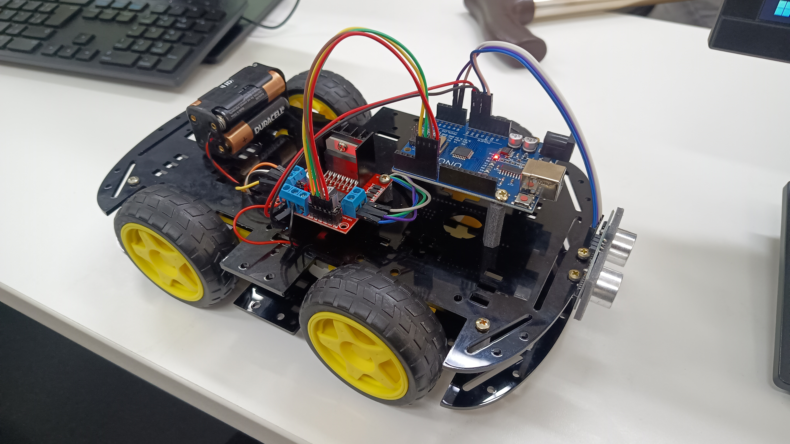
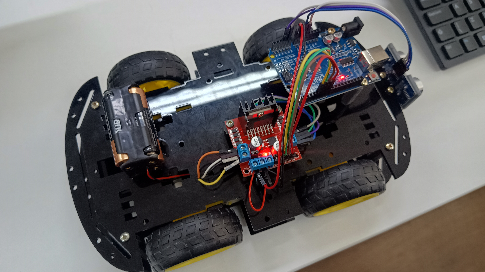
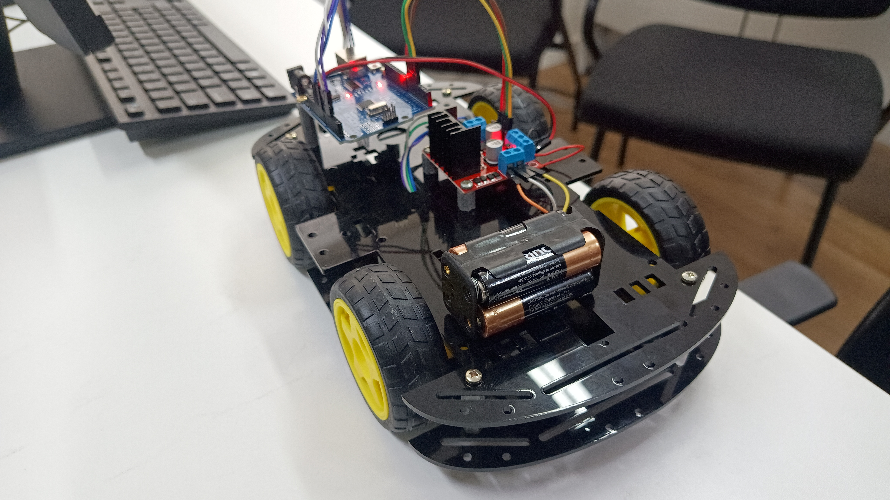
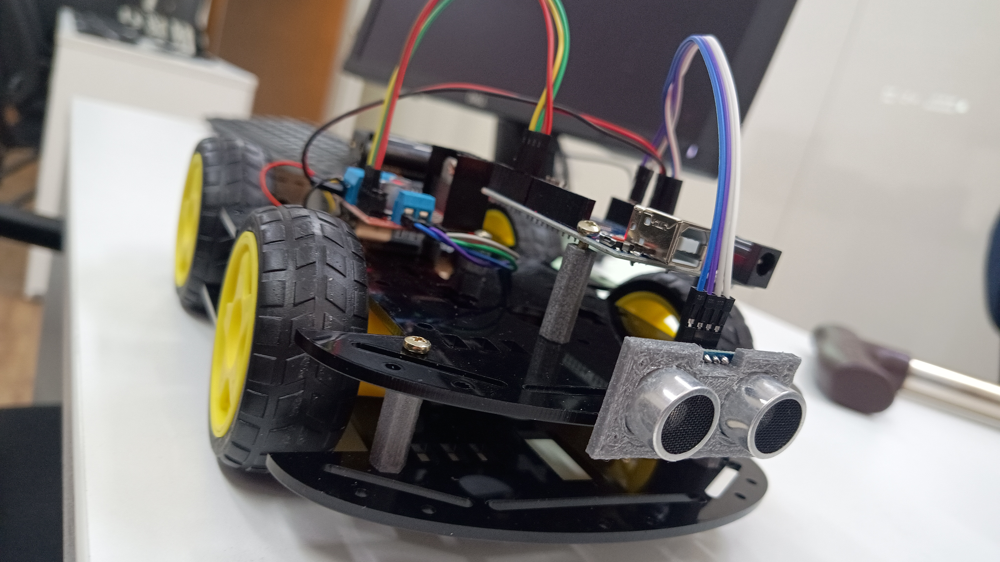
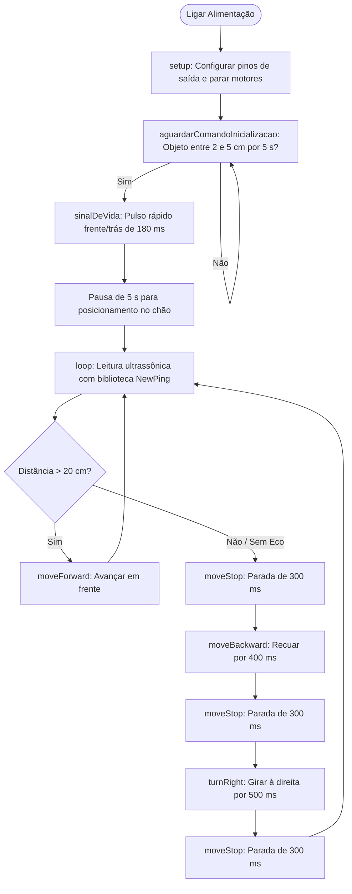
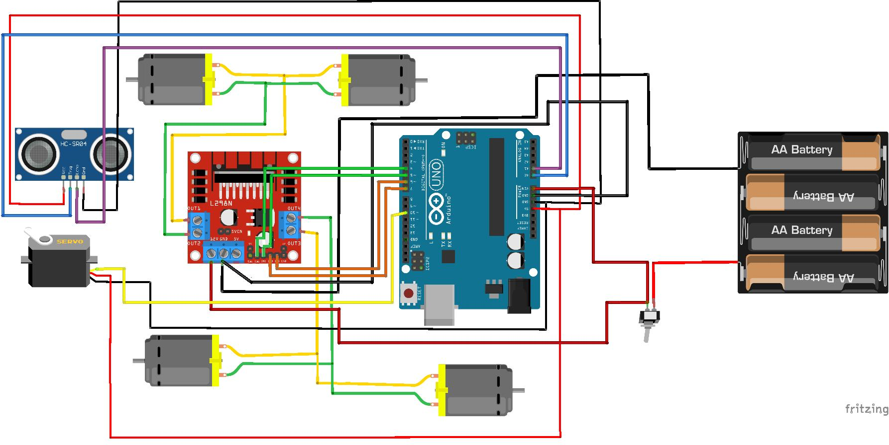
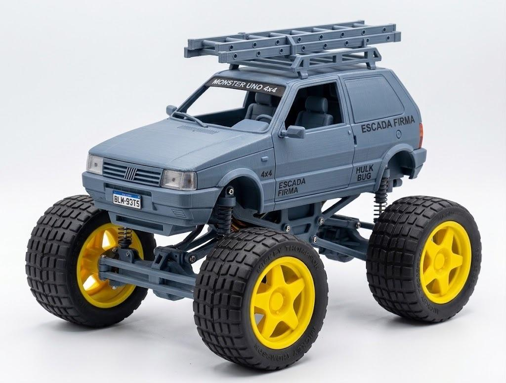
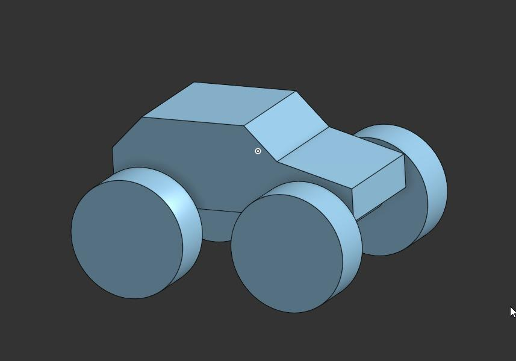

# Carrinho Robótico Autônomo 4WD com Arduino

Projeto prático desenvolvido para a disciplina de **Maker / Engenharia** da **FIAP**.

O projeto consiste na montagem e programação de um veículo robótico autônomo com tração nas quatro rodas (4WD), controlado por um **Arduino Uno R3** e um driver de motor **Ponte H L298N**. A navegação e o desvio de obstáculos são realizados de forma reativa a partir das leituras de um **Sensor Ultrassônico HC-SR04** instalado na parte frontal do veículo.

---

## Integrantes

| RM | Nome |
| :---: | :--- |
| **551117** | Lorenzo Gomes Andreata |
| **97158** | Lucas Moreno Matheus |
| **99756** | Kayky Oliveira Schunck |

---

## Visão Geral do Funcionamento

O veículo opera em circuito fechado sem necessidade de controle remoto ou comandos externos:

1. **Tração 4WD:** Quatro motores DC com caixa de redução (1:48) independentes, acionados em pares (lado esquerdo e lado direito) pelo driver Ponte H L298N.
2. **Sensoriamento Frontal:** Sensor HC-SR04 monitora continuamente a distância frontal até 250 cm.
3. **Partida Segura por Proximidade:** Ao ser ligado, o robô entra em estado de espera. A ativação ocorre apenas se um objeto for mantido entre 2 cm e 5 cm do sensor por 5 segundos contínuos, com contagem regressiva via comunicação serial.
4. **Autoteste de Motores:** Após a confirmação, o firmware aciona brevemente os motores para frente e para trás (180 ms) para validar a resposta mecânica, aguardando 5 segundos antes de iniciar a locomoção para que o operador possa posicioná-lo no chão com segurança.
5. **Navegação com Desvio à Direita:** O carrinho avança em linha reta enquanto a distância frontal for superior a 20 cm. Ao detectar uma barreira a 20 cm ou menos, o veículo interrompe o avanço, recua por 400 ms e gira sobre o próprio eixo para a direita por 500 ms antes de retomar a leitura e prosseguir.

---

## Registro Fotográfico

Imagens reais do carrinho montado e cabeado (disponíveis em [`assets/carrinho/`](assets/carrinho/)):

| Vista em Perspectiva | Vista Superior (Eletrônica e Fiação) |
| :---: | :---: |
|  |  |
| *Montagem do chassi duplo em acrílico, motores e fixação do Arduino* | *Disposição do Arduino Uno, Ponte H L298N e conexões* |

| Vista Traseira (Alimentação) | Vista Frontal (Sensor de Distância) |
| :---: | :---: |
|  |  |
| *Suporte de pilhas AA instalado na plataforma posterior* | *Sensor ultrassônico HC-SR04 montado na parte frontal do chassi* |

---

## Vídeos de Demonstração

Os ensaios práticos gravados estão disponíveis em [`assets/carrinho/`](assets/carrinho/):

### 1. Ensaio de Navegação Autônoma e Desvio de Obstáculos
Demonstração do carrinho em deslocamento contínuo pelo solo, detectando barreiras, recuando e executando as manobras de giro à direita.

https://github.com/user-attachments/assets/5e3ba238-4add-4b36-9cc3-faea7790a856

> **Arquivo do vídeo:** [`assets/carrinho/vid2.mp4`](assets/carrinho/vid2.mp4)

### 2. Teste de Partida e Reação Frontal
Demonstração da leitura frontal e acionamento da manobra de parada/recuo frente a aproximações de obstáculos.

https://github.com/user-attachments/assets/8d64f554-36b3-40b0-92b0-a601ae4ed8c9

> **Arquivo do vídeo:** [`assets/carrinho/vid1.mp4`](assets/carrinho/vid1.mp4)

---

## Lógica de Controle e Firmware

O código-fonte completo está localizado em [`codigo-carrinho-monster/codigo-carrinho-monster.ino`](codigo-carrinho-monster/codigo-carrinho-monster.ino).

### Fluxograma de Operação

### Principais Decisões de Implementação

- **Biblioteca `NewPing`:** Utilizada para emissão e recepção de ecos com filtro de ruído e temporização de 70 ms entre pulsos, retornando `-1` em caso de perda de sinal ou leitura fora da faixa (comportamento tratado como obstáculo para evitar colisões).
- **Manobra Diferencial (`turnRight`):** Para efetuar a curva em torno do próprio eixo em um chassi 4WD sem esterçamento mecânico nas rodas dianteiras, os motores esquerdos são acionados para frente (`LeftMotorForward = HIGH`) e os motores direitos para trás (`RightMotorBackward = HIGH`).

---

## Lista de Componentes

| Quantidade | Componente | Descrição / Função |
| :---: | :--- | :--- |
| 1 | Arduino Uno R3 (ATmega328P) | Microcontrolador central |
| 1 | Driver de Motor Ponte H L298N | Controle de potência e sentido de rotação dos 4 motores |
| 4 | Motores DC com Caixa de Redução (1:48) | Tração das rodas do chassi |
| 4 | Rodas de borracha | Aderência e deslocamento mecânico |
| 1 | Sensor Ultrassônico HC-SR04 | Detecção de distância e obstáculos frontais |
| 1 | Kit Chassi 4WD em Acrílico Duplo | Estrutura mecânica, espaçadores e parafusos de fixação |
| 1 | Suporte para 4 pilhas AA | Alimentação do conjunto |

---

## Esquema Elétrico e Conexões

### Pinagem no Arduino Uno

| Módulo / Sensor | Pino do Dispositivo | Pino no Arduino | Função |
| :--- | :--- | :---: | :--- |
| **Driver L298N** | IN1 | **D7** | Motor Esquerdo — Frente |
| **Driver L298N** | IN2 | **D6** | Motor Esquerdo — Trás |
| **Driver L298N** | IN3 | **D4** | Motor Direito — Frente |
| **Driver L298N** | IN4 | **D5** | Motor Direito — Trás |
| **HC-SR04** | Trig | **A1** | Emissão de pulso ultrassônico |
| **HC-SR04** | Echo | **A2** | Recepção do eco ultrassônico |
| **Alimentação** | GND | **GND** | Referência comum de terra |
| **Alimentação** | 5V | **5V** | Alimentação lógica de sensores |

### Diagrama de Ligações
Esquema de referência para interligação do Arduino Uno ao módulo L298N e motores DC:

---

## Modelagem CAD e Estudos de Design

Como parte do processo de desenvolvimento, foram elaborados estudos conceituais, modelagens tridimensionais e o levantamento dimensional dos componentes:

### Ideação Conceitual (IA Generativa)
Na etapa inicial de brainstorming para definição estética e proporções visuais do veículo, foi gerada uma imagem conceitual utilizando o Google Gemini:

### Estudo Volumétrico em CAD
Para visualizar o arranjo físico geral e a ocupação de espaço dos módulos no veículo, foi desenvolvido um modelo 3D conceitual:

### Modelagem 3D do Chassi de Acrílico
Como referência geométrica para fixação mecânica, foi elaborada uma diagramação tridimensional aproximada da placa de chassi em acrílico que acompanha o kit físico do carrinho:

* **Arquivo STL:** O modelo tridimensional da placa do chassi está disponível em [assets/Chassi.stl](assets/Chassi.stl).

### Tabela Dimensional de Referência
Levantamento das dimensões reais dos componentes utilizados no projeto, servindo de base para o arranjo físico e furação no chassi:

| Componente | Dimensões (Comprimento x Largura) | Altura |
| :--- | :---: | :---: |
| **Arduino Uno R3** | 68,6 mm x 53,4 mm | ~15,0 mm |
| **Motor DC com Caixa de Redução** | 70,0 mm x 23,0 mm | ~37,0 mm |
| **Driver Ponte H L298N** | 43,0 mm x 43,0 mm | ~27,0 mm |
| **Sensor Ultrassônico HC-SR04** | 45,0 mm x 20,0 mm | ~15,0 mm |

---

## Como Carregar e Executar

1. **Pré-requisitos de Software:**
   - Instalar a [Arduino IDE](https://www.arduino.cc/en/software) (versão 2.x recomendada).
   - Instalar a biblioteca **NewPing** no Gerenciador de Bibliotecas da Arduino IDE (`Sketch > Incluir Biblioteca > Gerenciar Bibliotecas...`, buscar por `NewPing` por Tim Eckel).

2. **Upload do Firmware:**
   - Conectar o Arduino Uno ao computador via cabo USB.
   - Abrir o arquivo [`codigo-carrinho-monster/codigo-carrinho-monster.ino`](codigo-carrinho-monster/codigo-carrinho-monster.ino).
   - Selecionar a placa **Arduino Uno** e a porta serial identificada (ex.: `COM3` no Windows ou `/dev/ttyUSB0` no Linux).
   - Clicar em **Carregar** (`Ctrl + U`).

3. **Operação do Carrinho:**
   - Ligar a chave do suporte de pilhas.
   - Posicionar a mão a cerca de 3 cm na frente do sensor ultrassônico durante 5 segundos para destravar a inicialização.
   - Após o autoteste rápido dos motores, colocar o carrinho no solo antes que a contagem de tolerância (5 segundos) expire.
   - O robô iniciará a navegação autônoma.
